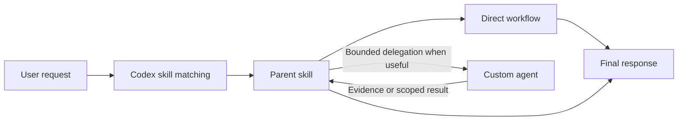

# AI-Devkit

AI-Devkit is a growing collection of reusable Codex skills and focused custom agents. It serves two purposes: a practical personal toolkit for recurring work and a public, inspectable example of how to design agent workflows with clear ownership, bounded delegation, and evidence-backed verification.

The repository includes a completed developer foundation plus profile-aware everyday workflows. It currently provides eight parent skills and nine supporting custom agents, with additional everyday, news, and personal-finance workflows planned. Private user profiles remain outside the repository.

## How It Works

Skills own complete workflows. A matching skill can handle a task directly or delegate a narrow investigation, implementation, review, or evaluation to a custom agent. The parent skill remains responsible for scope, decisions, synthesis, and the final response.



The diagram shows the intended ownership model. Custom-agent availability and tool access still depend on the active Codex environment.

## Developer Skills

| Skill | Purpose |
| --- | --- |
| [`codebase-map`](skills/codebase-map/SKILL.md) | Map repository structure, entrypoints, architecture, commands, and contribution paths. |
| [`api-integration-builder`](skills/api-integration-builder/SKILL.md) | Design, implement, review, and debug reliable REST, GraphQL, RPC, SDK, and webhook integrations. |
| [`docs-writer-dev`](skills/docs-writer-dev/SKILL.md) | Create and audit developer documentation, setup guides, API references, runbooks, and architecture diagrams. |
| [`prompt-engineer`](skills/prompt-engineer/SKILL.md) | Design, revise, debug, and evaluate prompts, tool policies, structured outputs, and agent instructions. |
| [`mcp-server-builder`](skills/mcp-server-builder/SKILL.md) | Design, build, secure, test, connect, and deploy Model Context Protocol servers. |
| [`plugin-packager`](skills/plugin-packager/SKILL.md) | Assemble, validate, install, test, and prepare Codex or Agent Plugin packages for release. |

Each skill includes `agents/openai.yaml` metadata for display and invocation in supported Codex surfaces. Exact discovery and invocation behavior depends on the installed Codex version.

## Everyday Skills

| Skill | Purpose |
| --- | --- |
| [`decision-helper`](skills/decision-helper/SKILL.md) | Frame choices, compare tradeoffs, test uncertainty and reversibility, rank options, and identify a practical next step. |
| [`research-brief`](skills/research-brief/SKILL.md) | Investigate questions, evaluate sources, reconcile evidence, verify claims, and produce a cited brief. |

Everyday skills read only their relevant section plus `Communication` from a private `personal.md`. The current request always takes precedence, and profile changes require explicit confirmation.

## Custom Agents

| Agent | Access | Responsibility |
| --- | --- | --- |
| [`repo_explorer`](.codex/agents/repo_explorer.toml) | Read-only | Gather repository structure, execution paths, commands, and file-level evidence. |
| [`implementation_worker`](.codex/agents/implementation_worker.toml) | Workspace write | Apply an approved, bounded change while preserving existing work. |
| [`test_and_verification`](.codex/agents/test_and_verification.toml) | Workspace write | Run proportionate checks, classify failures, and report worktree impact. |
| [`security_reviewer`](.codex/agents/security_reviewer.toml) | Read-only | Trace trust boundaries and report evidence-backed security findings. |
| [`docs_auditor`](.codex/agents/docs_auditor.toml) | Read-only | Compare documentation, examples, and diagrams with repository behavior. |
| [`eval_runner`](.codex/agents/eval_runner.toml) | Workspace write | Execute frozen evaluation contracts and expose regressions, scores, cost, and uncertainty. |
| [`tradeoff_analyst`](.codex/agents/tradeoff_analyst.toml) | Read-only | Compare bounded options, criteria, evidence, uncertainty, reversibility, and opportunity costs. |
| [`research_scout`](.codex/agents/research_scout.toml) | Read-only | Discover authoritative sources, trace primary evidence, and map disagreements and gaps. |
| [`claim_verifier`](.codex/agents/claim_verifier.toml) | Read-only | Check material claims against proposed sources for support, scope, freshness, and qualifiers. |

`workspace-write` identifies the Codex sandbox available to an agent. Each agent definition adds narrower behavioral limits, including restrictions on source edits, dependencies, external systems, Git operations, and destructive actions.

## Repository Structure

```text
AI-Devkit/
|-- .codex/
|   `-- agents/             # Project-scoped custom agent definitions
|-- docs/
|   `-- profile-setup.md    # Hybrid profile setup and privacy contract
|-- profiles/
|   |-- finance.example.md  # Placeholder-only financial profile
|   `-- personal.example.md # Placeholder-only everyday profile
|-- skills/
|   |-- api-integration-builder/
|   |-- codebase-map/
|   |-- decision-helper/
|   |-- docs-writer-dev/
|   |-- mcp-server-builder/
|   |-- plugin-packager/
|   |-- prompt-engineer/
|   `-- research-brief/
`-- README.md
```

Every skill directory currently contains:

```text
skill-name/
|-- SKILL.md                # Trigger description and workflow instructions
`-- agents/
    `-- openai.yaml         # User-facing skill metadata
```

## Local Installation

This repository does not yet include an automated installer. Review the files before installing them into a personal Codex environment. Run the commands below from the cloned repository root.

The locations and invocation behavior in this section follow the current [Codex skill documentation](https://learn.chatgpt.com/docs/build-skills) and [Codex subagent documentation](https://learn.chatgpt.com/docs/agent-configuration/subagents). The copy commands have been tested against an isolated home directory; automatic discovery still depends on the user's Codex version and configuration.

### Install Skills

Current Codex documentation identifies `$HOME/.agents/skills` as the user-level skill location. Copy the skill directories you want to use:

```bash
mkdir -p "$HOME/.agents/skills"
cp -R skills/codebase-map "$HOME/.agents/skills/"
cp -R skills/api-integration-builder "$HOME/.agents/skills/"
cp -R skills/docs-writer-dev "$HOME/.agents/skills/"
cp -R skills/prompt-engineer "$HOME/.agents/skills/"
cp -R skills/mcp-server-builder "$HOME/.agents/skills/"
cp -R skills/plugin-packager "$HOME/.agents/skills/"
cp -R skills/decision-helper "$HOME/.agents/skills/"
cp -R skills/research-brief "$HOME/.agents/skills/"
```

### Install Custom Agents

Current Codex documentation supports project-scoped definitions under `.codex/agents` and personal definitions under `$HOME/.codex/agents`. To make these definitions available from other projects, copy them to the personal directory:

```bash
mkdir -p "$HOME/.codex/agents"
cp .codex/agents/*.toml "$HOME/.codex/agents/"
```

Open a new Codex task after installation. Current Codex documentation states that skill changes are detected automatically and recommends restarting Codex when a new skill does not appear.

The agent definitions currently select `gpt-5.6-terra` with medium reasoning effort. Review those settings before installation if that model is unavailable in the target environment.

### Set Up Optional Profiles

The repository includes placeholder-only personal and financial profile templates. Completed profiles belong outside Git and are optional until a profile-aware skill needs them.

See [Profile Setup](docs/profile-setup.md) for paths, precedence, privacy boundaries, setup commands, and the confirmation flow for saved preference changes.

## Usage

Current Codex versions can select a skill implicitly when a request matches the skill's description:

```text
Map this repository and show me the safest contribution path.
```

Skills can also be invoked explicitly in Codex with `$skill-name`:

```text
Use $prompt-engineer to review this tool-using system prompt.
```

More examples:

```text
Connect this service to the GitHub REST API and handle retries and rate limits.

Write an architecture guide for this repository and include a readable Mermaid diagram.

Build a local stdio MCP server for these read-only project operations.

Package these skills and MCP components as one installable plugin.

Help me decide between these options, show the decisive tradeoffs, and recommend the next step.

Research this topic and give me a sourced brief that separates evidence, disagreement, and uncertainty.
```

When a skill delegates work, the custom agent returns a scoped result to the parent skill. The parent reconciles the evidence and produces the final answer.

## Design Principles

- **Parent ownership:** skills retain final scope, judgment, and synthesis.
- **Bounded delegation:** custom agents receive narrow objectives, explicit permissions, and return contracts.
- **Evidence before claims:** repository behavior, commands, documentation, and evaluations are checked rather than assumed.
- **Least necessary access:** read-only agents stay read-only; write-capable agents remain constrained by task scope.
- **Independent checks:** implementation, verification, security review, documentation audit, and evaluation remain distinct responsibilities.
- **Public-safe personalization:** personal values live outside Git, while repository templates contain placeholders and generic workflows.
- **Financial boundaries:** planned finance skills provide education, calculations, and neutral scenarios only; they do not prescribe financial, investment, tax, or legal actions.

## Financial Use Disclaimer

Planned financial workflows are for general education and personal organization. They are not financial, investment, tax, or legal advice and are not a substitute for a licensed or otherwise qualified professional. Every substantive financial response must display that disclaimer. These workflows will not tell users what financial action to take; recommend specific securities, products, providers, legal strategies, or tax positions; or make legal or tax determinations. Users remain responsible for their decisions and must be directed to an appropriate professional for consequential, regulated, or jurisdiction-specific matters.

## Roadmap

| Phase | Status | Planned work |
| --- | --- | --- |
| Developer skills | Complete | Six reusable developer workflows. |
| Developer subagents | Complete | Six focused agents connected to the parent skills. |
| Everyday skills | In progress | Decision support and research briefs are implemented; writing, learning, and news are planned. |
| Profile foundation | Available | Public placeholder templates, private-path conventions, and opt-in update rules; decision and research integrations are available. |
| Financial skills | Planned | Personal-finance review and budgeting with a separate private financial profile. |
| Distribution | Planned | Automated installation, plugin packaging, clean-user testing, and release documentation. |

The repository does not currently include a release package, automated installer, contribution guide, or license. Those surfaces will be added and validated before a public release.

## Privacy Direction

Developer skills and agents do not use personal profiles. The profile foundation is documented in [Profile Setup](docs/profile-setup.md). Implemented and planned everyday and financial skills follow this hybrid model:

- generic behavior and profile schemas remain public;
- completed personal profiles remain outside the repository;
- skills read only the profile sections relevant to the current task;
- current user instructions override saved preferences;
- profile changes require explicit confirmation;
- financial context remains separate from everyday preferences.

The templates and setup contract are available now. No developer skill reads either profile. The decision helper and research brief read only their relevant sections of `personal.md`; other profile-aware behavior will be added only as corresponding skills are implemented.
