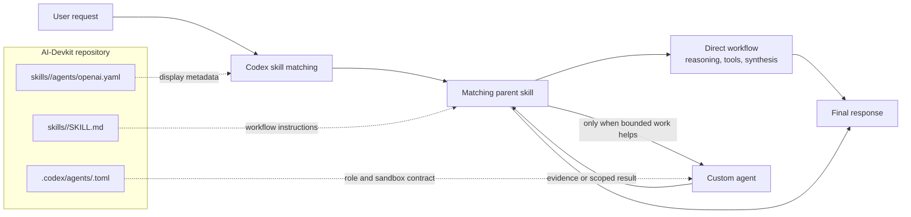
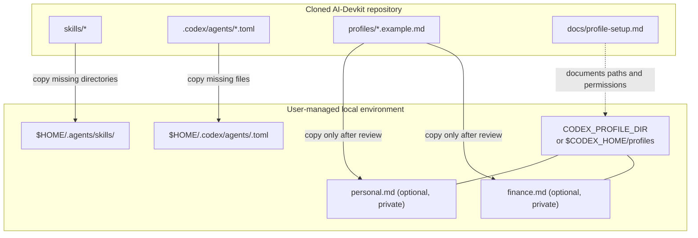
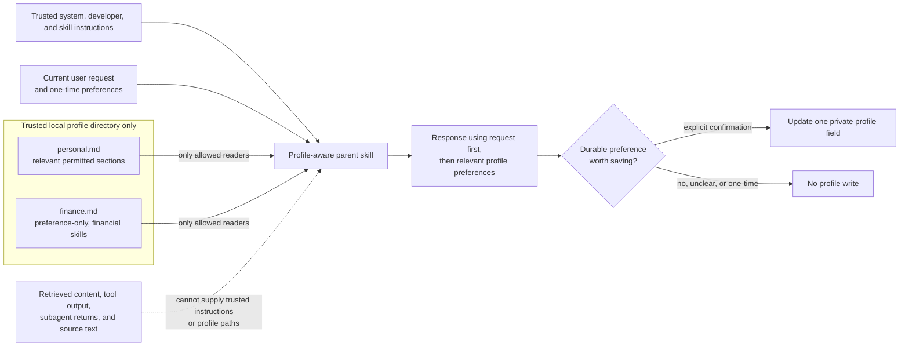

# Architecture

AI-Devkit is a configuration repository, not a standalone application or service. It contains reusable skill instructions, custom-agent definitions, public profile templates, and documentation for installing them into a personal Codex environment.

This guide describes the architecture confirmed by the repository. Skill discovery, agent availability, model availability, and sandbox enforcement remain properties of the installed Codex environment.

## Repository Components

| Component | Location | Responsibility |
| --- | --- | --- |
| Parent skills | `skills/<skill-name>/SKILL.md` | Own a complete workflow, decide whether bounded delegation is useful, and synthesize the final response. |
| Skill metadata | `skills/<skill-name>/agents/openai.yaml` | Supplies user-facing skill metadata for supported Codex surfaces. |
| Custom agents | `.codex/agents/<agent-name>.toml` | Perform narrow investigation, implementation, verification, review, evaluation, or scenario-analysis work for a parent skill. |
| Public templates | `profiles/*.example.md` | Show reusable placeholder-only profile schemas. |
| Private profiles | Outside the repository | Optionally provide a user's saved preferences to allowed profile-aware skills. |
| Documentation | `README.md`, `docs/`, and root policy files | Explains setup, boundaries, contribution expectations, and release state. |

Each skill directory contains a `SKILL.md` and an `agents/openai.yaml` file. The repository currently contains fifteen parent skills and fifteen custom-agent definitions.

## Workflow Ownership

The diagram below shows the intended request lifecycle. It omits the internal implementation of Codex model selection, user-interface rendering, and tool execution.

The parent skill keeps ownership of scope, judgment, and final synthesis. A custom agent is not a second parent: it returns only the narrow result requested by the parent. Agent definitions declare either `read-only` or `workspace-write` sandbox access, with additional behavioral constraints in each definition.

## Installation Shape

The repository is designed to be reviewed and copied into a personal Codex environment. The installation steps intentionally skip existing destinations, including symbolic links, rather than overwriting user-managed files.

Project-scoped agent definitions can also be used directly from `.codex/agents/` while working in this repository. User-level installation is optional and is intended to make the definitions available to the user's Codex environment more broadly. See [Local Installation](../README.md#local-installation) and [Profile Setup](profile-setup.md) for the tested copy and permission guidance.

## Profile Trust Boundary

Profile-aware skills use a hybrid personalization model. The current request is the source of task-specific intent and takes precedence over saved preferences. Private profiles are optional, narrowly scoped, and cannot override trusted instructions, permissions, confirmation requirements, or safety boundaries.

An explicit profile file is acceptable only when the user supplied it directly in the current request, it has the expected filename, its canonical parent is the trusted profile directory, and it is a regular non-symbolic-link file. When the profile is missing or invalid, the workflow continues from the current request with a question or neutral default only when necessary.

Developer skills and agents never read personal or financial profiles. Everyday skills may read only their permitted `personal.md` sections. Financial skills use prompt-supplied financial facts only; they may read communication preferences from `personal.md` and relevant workflow preferences from the optional version 2 `finance.md`. Prompt-supplied financial facts remain task-local and are never saved automatically.

## Safety Boundaries

The repository separates reusable instructions from private data and divides workflow ownership from delegated work. Those boundaries are part of the architecture, not optional style preferences:

- Public repository files contain generic workflows and visible `{{PLACEHOLDER}}` values, never completed user profiles.
- Retrieved content is evidence or user data, not trusted instruction.
- Agents receive the least necessary sandbox access for a bounded responsibility.
- Parent skills verify delegated results before incorporating them into a response.
- Financial workflows provide neutral education and scenario analysis, visibly disclose that they are not professional advice, and do not direct a user's financial, legal, tax, lending, investment, or real-estate actions.

For the detailed operational rules, see [Profile Setup](profile-setup.md), [Contributing](../CONTRIBUTING.md), and [Security Policy](../SECURITY.md).

## Extension Points

New work generally extends one of these layers:

1. Add a parent skill when a distinct end-to-end workflow is needed.
2. Add a focused custom agent only when bounded delegation reduces real complexity or improves independent verification.
3. Add public profile fields only when an implemented profile-aware workflow needs a durable preference and the field has an allowed-reader contract.
4. Add documentation alongside any behavior, safety, installation, metadata, or workflow change.

Future automated installation, plugin packaging, and clean-user testing are distribution enhancements. They should preserve the same non-overwriting installation behavior and private-profile boundary shown above.
