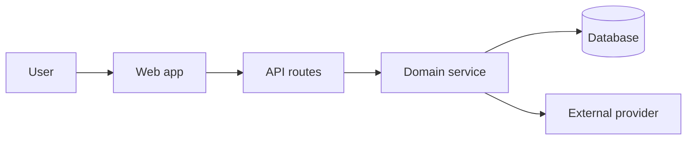

# Developer Docs Writer

Create developer documentation that is accurate, scannable, and grounded in the codebase. Favor docs that help someone do real work: install, run, understand, integrate, debug, contribute, operate, or extend the project.

## Trigger Interpretation

Use this skill for prompts such as:

- "Write a README for this repo."
- "Improve the docs."
- "Document this API/module/component."
- "Create setup instructions."
- "Explain the architecture."
- "Create an architecture diagram."
- "Add a diagram showing how the system works."
- "Write a contribution guide."
- "Create a runbook for deployment/debugging."
- "Add usage examples."
- "Update docs after this code change."
- "Make this documentation clearer for developers."

If the user asks for marketing copy, investor copy, end-user help content, or general prose, use a writing/editing skill instead unless developer implementation detail is central.

## Workflow

1. Identify the documentation job.
   - Determine doc type: README, setup guide, API reference, architecture note, runbook, contribution guide, migration guide, example, inline comment, changelog, or troubleshooting page.
   - Determine audience: first-time contributor, maintainer, API consumer, app developer, operator, reviewer, or future self.
   - Determine the expected action after reading: run the app, call an API, make a change, debug an issue, deploy, or understand tradeoffs.

2. Ground the docs in source evidence.
   - Inspect existing docs, package manifests, scripts, config, entrypoints, tests, examples, CI, deployment files, and relevant code.
   - Prefer actual commands and behavior found in the repo over assumptions.
   - Mark inferred information clearly when it cannot be verified from files.
   - Do not document features, commands, env vars, APIs, or guarantees that are not supported by the code.

3. Choose the right structure.
   - README: purpose, quick start, common commands, structure, configuration, development workflow, testing, deployment, contribution notes.
   - Setup guide: prerequisites, install, environment variables, local services, seed/migrate steps, run commands, verification, troubleshooting.
   - API docs: endpoint/function purpose, auth, parameters, request examples, response examples, errors, pagination/rate limits, versioning.
   - Architecture note: context, system shape, data flow, module boundaries, readable diagrams, important decisions, tradeoffs, extension points.
   - Runbook: symptoms, impact, checks, commands, rollback, escalation, post-fix verification.
   - Contribution guide: workflow, branch/commit norms, commands, test expectations, review criteria, release notes.

4. Write with developer ergonomics.
   - Start with the most useful path, then add detail.
   - Use concrete commands, paths, examples, and expected results.
   - Keep headings task-oriented.
   - Prefer short paragraphs and lists that support scanning.
   - Include copy-pasteable commands only when they are safe and repo-accurate.
   - Explain why only where it helps avoid misuse.

5. Validate the result.
   - Check commands against scripts/config when possible.
   - Check file paths and exported names.
   - Check API examples against actual types or route handlers.
   - Preserve existing project tone and documentation conventions.
   - If editing an existing doc, avoid unrelated rewrites unless clarity requires it.

## Architecture Diagrams

Create readable but detailed architecture diagrams when they would help the developer understand system structure, data flow, deployment shape, service boundaries, request lifecycle, or integration points.

Prefer Mermaid diagrams in Markdown unless the project uses another diagram format. Keep diagrams source-controlled and editable as text.

Use the diagram type that matches the job:

- System overview: `flowchart` showing apps, services, databases, queues, external providers, and major boundaries.
- Request/data flow: `sequenceDiagram` or `flowchart` showing the path through UI, API, services, storage, and external systems.
- Module architecture: `flowchart` showing packages, modules, shared utilities, and dependencies.
- Deployment/runtime: `flowchart` showing environments, processes, workers, storage, queues, and third-party services.
- State or lifecycle behavior: `stateDiagram-v2` when state transitions are central.

Diagram rules:

- Ground every node and connection in source evidence or label it as inferred.
- Use concise node labels that match repo terminology.
- Group related components with Mermaid subgraphs when the diagram has more than 6-8 nodes.
- Show boundaries that matter: frontend/backend, app/service/data, internal/external, sync/async, trusted/untrusted.
- Include a short caption explaining what the diagram shows and what it intentionally omits.
- Do not overfill diagrams with every file or class; include details that change how a developer understands or modifies the system.
- If a diagram would be speculative, write a "confirmed vs inferred" note instead of presenting it as fact.

Example shape:



## Prompting Guidance

When using this skill, adapt to the user's request:

- For "write docs": inspect the repo first, then create the doc with evidence-backed commands and examples.
- For "improve docs": identify gaps, stale claims, confusing order, missing prerequisites, and unclear examples before editing.
- For "document this code": read the target code and nearby tests before writing behavior claims.
- For "architecture docs": map actual modules and data flow; do not produce generic architecture filler.
- For "setup docs": include prerequisites, exact commands, env vars, local services, verification, and troubleshooting.
- For "API docs": include request/response/error examples and auth requirements when available.
- For "make it public/interviewer-ready": keep it polished, concise, and honest about project maturity.

Use precise phrases:

- Prefer "Run `npm run dev`; it starts Vite on the configured dev server" over "start the app."
- Prefer "Create `.env.local` with `DATABASE_URL`" over "set up environment variables."
- Prefer "This repo currently has no test script in `package.json`" over "tests are not configured."

Ask a clarifying question only when the audience, target doc, or desired depth is unclear enough to materially change the output. Otherwise choose the most useful default and proceed.

## Output Format

For creating or editing docs, report:

```text
Documentation created/updated:
- File and purpose.

Audience:
- Who the doc is for and what it helps them do.

Content covered:
- Main sections or topics.

Evidence checked:
- Files/scripts/configs used to keep the docs accurate.

Open questions:
- Anything that could not be verified from the repo.
```

For docs review without editing, report:

```text
Findings:
- Stale, missing, confusing, or risky documentation issues with file references.

Recommended structure:
- How the doc should be organized.

Suggested edits:
- Concrete changes or replacement text.
```

## Quality Bar

Developer docs should be:

- Accurate: every command, path, API, and env var should match source evidence.
- Actionable: readers should know what to do next.
- Scannable: headings and examples should make the doc easy to skim.
- Honest: unknowns and TODOs should be explicit, not hidden behind vague language.
- Maintainer-friendly: avoid over-documenting implementation details that will churn quickly.
- Public-ready when needed: polished enough for interviewers or collaborators to understand the project.

## Future Subagents

When custom agents exist, this skill can call:

- `docs-auditor`: compare docs against code, scripts, examples, and tests for stale or unsupported claims.
- `repo-explorer`: map relevant source files before writing architecture or setup docs.
- `test-and-verification`: run documented commands and confirm outputs.
- `synthesis-editor`: polish rough technical notes into clear final documentation.
- `api-contract-reviewer`: verify API documentation against route handlers, schemas, and integration code.

## Guardrails

- Do not invent project maturity, features, commands, public APIs, environment variables, deployment targets, or test coverage.
- Do not hide uncertainty. Use "not found" or "could not verify" when source evidence is missing.
- Do not overwrite an existing doc's useful structure without preserving important project-specific details.
- Do not include secrets, private URLs, internal credentials, or sensitive operational details in public docs.
- Do not add long, decorative prose where a command, example, or file reference would be more useful.
